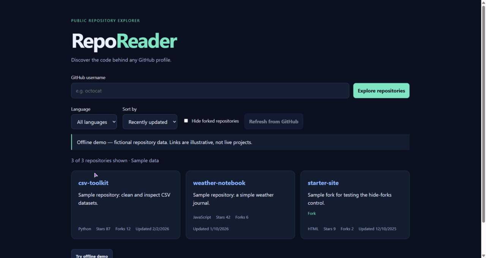

# RepoReader

A responsive, zero-dependency dashboard for exploring public GitHub repositories. Built with vanilla HTML, CSS, and JavaScript. No login, token, database, or paid API is required.

## Preview



## Features
- Search a GitHub username and fetch public owned repositories across all pages.
- Filter by language (including unspecified languages), hide forks, and sort by recent updates, stars, forks, or name.
- Ten-minute local cache per username, manual refresh, and stale-cache fallback if the network/API fails.
- Clear handling for nonexistent users, rate limits, request timeouts, and unavailable browser storage.
- Responsive layout, labeled controls, keyboard focus indicators, live status announcements, and safely rendered API text.
- Offline sample dataset for trying the interface without API requests.

## Run
Open index.html in a modern browser. If your browser restricts network access from local files, serve this folder instead:

```sh
python -m http.server 8000
```

Then visit http://localhost:8000. On systems that use python3, substitute python3. Python is only needed for the optional server, not the app.

## Tests
With Node.js 18 or newer installed:

```sh
npm test
```

No npm install is needed. Tests cover validation, filtering, sorting, cache behavior, storage failure, and API error messages.

## Manual smoke test
1. Try offline demo; filter Python, sort by stars, and hide forks.
2. Search a public username; check repository links and compare data with GitHub.
3. Search again within ten minutes; confirm the cache message.
4. Refresh to bypass cache.
5. Disconnect networking and search a cached username after cache expiration; confirm the outdated-data warning.
6. Check a nonexistent username and a narrow mobile viewport.

## Architecture
- index.html: semantic interface
- styles.css: responsive dark theme
- core.js: pure filtering, validation, caching, error utilities
- app.js: paginated API fetches and safe DOM rendering
- tests/core.test.cjs: Node built-in test suite

## API, privacy, and limits
Uses GET https://api.github.com/users/{username}/repos with 100 results per page. Each page costs one API request. Requests are unauthenticated and subject to GitHub's current rate limits and abuse protections. The app reads response headers to report exhaustion; it does not bypass limits. See [GitHub rate-limit documentation](https://docs.github.com/en/rest/using-the-rest-api/rate-limits-for-the-rest-api) for current policy.

Only public data is supported. GitHub receives requests directly from your browser; this app has no backend or analytics. Repository responses are stored in your browser's local storage. Clear site data to remove them. Demo entries are fictional. Cached data may be outdated. All-page fetching can be slow for accounts with many repositories.

Required services cost zero: the app works as local static files and requires no paid plan or credit card. Existing hardware and internet access are assumed; assistance in Strawberry may consume credits. Hosting is optional and not required to run this project.

## Upload to GitHub
Create an empty repository in your own account, then run in this folder (replace the URL with your actual repository URL):

```sh
git init
git add .
git commit -m "Build RepoReader dashboard"
git branch -M main
git remote add origin https://github.com/abzz-bit/RepoReader.git
git push -u origin main
```

Before publishing, add a screenshot of your running app and update this README with your demo or repository link. Never commit credentials or tokens.

## Next improvements
- Add integration tests with mocked network responses.
- Export filtered repositories to CSV.
- Add text search and accessible light/dark themes.

## License
MIT — see LICENSE.

## Verification for this build
- Seven automated tests passed; app.js and core.js syntax checks passed.
- Browser smoke checks passed: offline demo, Python language filter, live octocat repository fetch, and subsequent cache reuse.
- Multi-page fetches, real rate-limit exhaustion, mobile layout, and timeout/stale fallback were not exercised end-to-end.


### RepoReader rename verification
Seven tests passed, including the renamed browser export and cache namespace. JavaScript syntax checks passed. The renamed app opened in the browser, the offline demo was exercised, and the preview screenshot was refreshed. Live API behavior was verified before the rename but not rerun after it. The new cache namespace starts fresh; older cache entries are no longer read.
